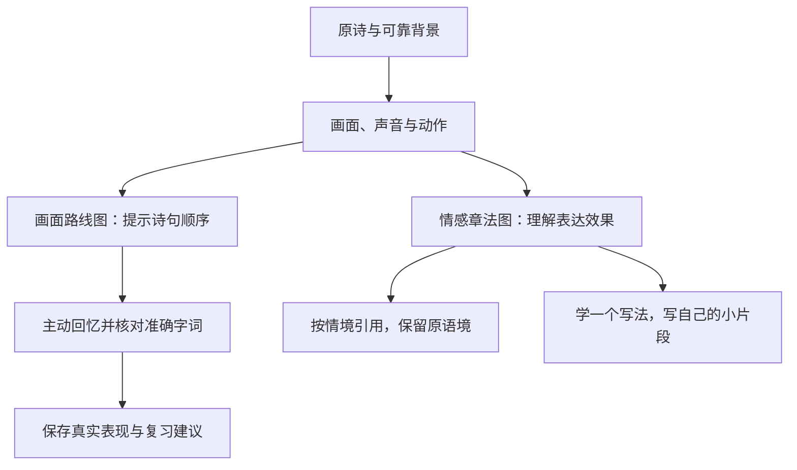

# shici：诗词精读、画面背诵与表达

一个面向古典诗词阅读的中文 agent skill。以可回查的笔记为基础，用 Mermaid 连接诗中的画面、动作与情感，帮助理解背景、准确背诵、按情境引用，并逐步学习写诗与填词。

它适合《唐诗三百首》、唐宋诗词选本、诗人别集和词集。阅读重点是作品的语言、情感和形式；不会把诗集变成处世原则清单。完整示例见 [《送元二使安西》](examples/送元二使安西.md)。

## 核心习惯

- **精读与笔记为主**：解释难词、必要背景、诗中场景与情感推进，保留原文和出处，支持以后查回去。
- **画面法背诵**：从读者自己的想象出发，把图像、动作、声音和情感转折连接到准确字词；不只记大意。
- **多用 Mermaid**：每首默认两张图，一张帮助按顺序回忆，一张说明情感与章法。比较、意象、典故与创作过程也可图解。
- **分类有层次**：体裁、题材、风格、情感、技法分别标记；词额外记录词牌及具体词体。
- **引用有语境**：按想念、离别、孤独、喜悦等日常情境检索，解释原意与当前感受的契合程度。
- **创作循序渐进**：从一个画面、一两个句子练起，再学节奏、押韵、近体诗形式和选定词牌的格律。

原始使用者已背过三十多首，喜欢想象画面；这个偏好写在 skill 中。其他读者也可明确覆盖偏好。没有具体篇目清单时，skill 不会猜哪些作品已背，也不会把生成笔记等同于学会。

## 安装

仓库：[zhouyanyu/shici-skill](https://github.com/zhouyanyu/shici-skill)。安装目录应叫 **shici**，与 `SKILL.md` frontmatter 一致。

### Windows PowerShell

```powershell
$taskSkillRoot = Join-Path $env:USERPROFILE '.codex\skills'
$taskSkillPath = Join-Path $taskSkillRoot 'shici'
New-Item -ItemType Directory -Path $taskSkillRoot -Force | Out-Null
if (Test-Path -LiteralPath $taskSkillPath) {
    throw 'shici 目录已存在，请先检查现有内容，勿覆盖个人定制。'
}
git clone 'https://github.com/zhouyanyu/shici-skill.git' $taskSkillPath
```

HTTPS 访问需要仓库可访问；私有仓库需已有认证。已配置 GitHub SSH 密钥的 Windows 用户可将 clone 行替换为：

```powershell
git -c 'core.sshCommand=C:/Windows/System32/OpenSSH/ssh.exe -o BatchMode=yes -o ConnectTimeout=15' clone 'git@github.com:zhouyanyu/shici-skill.git' $taskSkillPath
```

Windows OpenSSH 的选项仅用于兼容本机代理，不修改全局 Git 配置。如果设置了自定义 `CODEX_HOME`，把安装根目录改为该目录下的 `skills`。

### macOS / Linux

```bash
task_skill_root="${CODEX_HOME:-$HOME/.codex}/skills"
mkdir -p "$task_skill_root"
git clone https://github.com/zhouyanyu/shici-skill.git "$task_skill_root/shici"
```

目录已存在时先检查本地修改，不重新覆盖安装。若当前会话技能列表未刷新，重新打开会话后检查 `$shici` 是否可用；不能把复制文件描述为当前会话已经加载。

## 最简使用：文件＋skill

附上诗词书文件，然后说：

> 使用 `$shici` 整理这本书。

默认处理文件中全部可读诗词正文，逐首建立笔记和索引，按原书顺序分批连续完成，不逐批询问是否继续。组诗保留成员编号，词的重名靠作者、首句辨认。附部分作品则处理所提供范围；无法读取的部分如实记录。

默认目录为当前工作区的 `诗词笔记/书名-版本/`；已有目录或指定目的地优先。只问一个解释问题不会自动建整本 Wiki。只有书名而没有可靠全文时，可以介绍通行作品，但不能声称精读了某个具体版本的全书。

支持通过执行环境已有工具读取 EPUB、PDF、DOCX、HTML、Markdown 和文本；这不是内置全能解析器。EPUB 需保留原书顺序，扫描 PDF 可能需 OCR 并核对错字，无法读取就记录限制。诗句、现代注释与译文要分开保存。

## 常见用法

### 理解与笔记

> 使用 `$shici` 精读《登高》，重点讲画面如何转向身世感受，多用 Mermaid。

> 整理这组《出塞》，分别标明体裁、题材、风格和情感，说明每个标签的依据。

> 比较这两首送别诗：同样是送别，为什么给我的感觉不同？用图展示表达路径。

### 背诵与复习

> 我背这首时想象自己站在江边。沿用我的画面，帮我连接每一句，注意容易换错的字。

> 我已经背过这份清单中的作品，帮我建立复习记录。清单外的状态先留未知。

> 抽查这三首，先给画面提示；我回答后再核对，不要立即公布全文。

练习默认用主动回忆，逐步从看图、看关键词过渡到只看篇名背全篇；卡住时只修补相关句子。状态分别记录用户自述、本次实际表现、提示依赖与复习建议。复习间隔按表现调整，没有请求并成功创建自动化时不会主动提醒。

### 日常引用

> 朋友要去外地工作，我想发一句诗表达舍不得。优先从我背过的诗里选，并解释原语境。

> 给已有笔记增加“独处但自在”的入口；区别它与悲伤的孤独。

### 写诗与填词

> 今天下雨，我有点想家。先帮我练两句，用景物或动作表达，不直接说“想家”。

> 我想试填《如梦令》。选一种可靠词体，给我字数、句式、平仄和韵位，陪我逐句写。

> 这是我写的词，保留原稿。先评表达，再按我选定的词谱和韵书检查格律，说明每处修改的理由。

创作以用户真实感受为起点，不要求用典或强作古雅。助手示范、用户原稿、修改建议分开标识；默认不把助手代写记录为用户完成。

## 为什么标签要分开

| 维度 | 示例 | 用途 |
|---|---|---|
| 体裁 | 五绝、七绝、五律、七律、古体、词 | 认识形式 |
| 题材 | 边塞、战争、送别、思乡、咏物、山水田园、怀古 | 认识所写内容 |
| 风格 | 婉约、豪放、清新、雄浑、沉郁、含蓄 | 认识表达气质 |
| 情感 | 惜别、喜悦、孤独、悲愤、眷恋、旷达 | 理解感受及其变化 |
| 技法 | 白描、对照、虚实相生、用典、借景抒情 | 学习具体表达方式 |
| 词牌／词体 | 如梦令、浣溪沙的某种具体词体 | 填词时采用明确格式 |

“战争诗”和“边塞诗”可能交叉；“婉约”是风格；“出塞”可能是篇名或乐府题。标签不是互斥盒子，每个重要判断都回到诗句。作者通常的风格不能代替单篇分析。

## Mermaid 如何帮助学习



图中区分原诗事实、文学解读与记忆联想；心理想象不冒充实际行程，先后不冒充因果。每图通常保留少量关键节点，长篇分段、词分片；静景和抽象表达可以画意象关系，不强行编故事。

若第二种图确实无信息价值，或用户要求省略，可说明理由后省略。笔记默认输出 Mermaid 源码；能否显示取决于查看器。没有实际渲染器时只检查标准语法与图义，不声称渲染已通过。

## 宋词格律与学习边界

填词时先选定词牌的一种具体词体，注明谱源、范词、句式、韵位、平仄、分片及换韵／叠句要求。严格传统填词可选有来源的《钦定词谱》与《词林正韵》；用户指定其他规范则沿用并注明。

传统平仄不能直接按普通话四声推断，古入声和多音字需核对。词牌名不规定主题，同词牌不同词体不能混合。“字数相同”不等于合律；格律正确也不代表情感和用词自然。

本仓库**不包含完整词谱数据库、韵书数据库或自动格律判定器**。有可靠资料时逐项人工或借助环境工具核对；不可用时仍可练表达、句长和节奏，明确标注格律尚未核实，不编造韵部或合律结论。

## 输出档案与长期维护

```text
诗词笔记/书名-版本/
├── 阅读首页.md
├── 作品笔记/
├── 原文/                  有原书材料时
├── 分类索引.md
├── 背诵记录.md
├── 情境引用.md            按需
├── 创作练习/              实际发生后
└── 专题/                  有实质内容时
```

每首笔记包括原文、标签、字词背景、两张默认图、关键句解读、背诵卡和引用情境；按需要附轻量创作练习。首页保存版本、原书目录、已完成和剩余范围。材料提取、笔记完成、用户读过和背会分别记录。

接续时读取已有文件，不依赖聊天记忆。更新保留用户批注、画面联想与草稿，并检查文件链接及来源锚点。笔记文件适合 Markdown／Obsidian；实际 Mermaid 显示依赖查看器支持。

## 仓库结构

```text
shici-skill/
├── SKILL.md                       入口、范围与默认偏好
├── README.md                      安装、用法、默认行为与限制
├── agents/openai.yaml             技能界面信息
├── references/
│   ├── notes-and-wiki.md           单首模板、档案与来源
│   ├── mermaid.md                  图解语法与图义
│   ├── taxonomy.md                 分类与引用
│   ├── memory.md                   画面背诵、反馈与复习
│   ├── writing.md                  写诗填词与格律核对
│   └── repository-maintenance.md   skill 自身同步约定
└── examples/送元二使安西.md        完整公开方法示例
```

参考文件按当前请求加载，不要求每次全部读取。本仓库不需要 Python 或 Node 才能使用；文件解析、联网资料和可选 Mermaid 渲染取决于所在 agent 环境。

## 校验与发布

在拥有 Codex `skill-creator` 系统技能的环境中，可使用其 `scripts/quick_validate.py` 校验安装目录；该工具需要 Python 与 PyYAML。结构校验只检查技能元数据等基本条件，不能证明文学解读、背景考证或词律正确。还应检查内部引用、示例原文、图义和文档命令。

原始维护者约定：修改本 skill 时，同步更新 [发布仓库](https://github.com/zhouyanyu/shici-skill) 与必要 README。这个同步仅涵盖技能文件和公开示例；私人原书、笔记、背诵记录与创作草稿不上传，也不是后台定时任务。Fork 使用者维护自己的版本，不默认向原仓库推送。

古典原文与现代译注、排版、图片的权利分别处理。本例采用通行古诗和自行撰写的解释，未附现代选本全文。作品背景若有争议则保留分歧，不把记忆联想写成史实。
