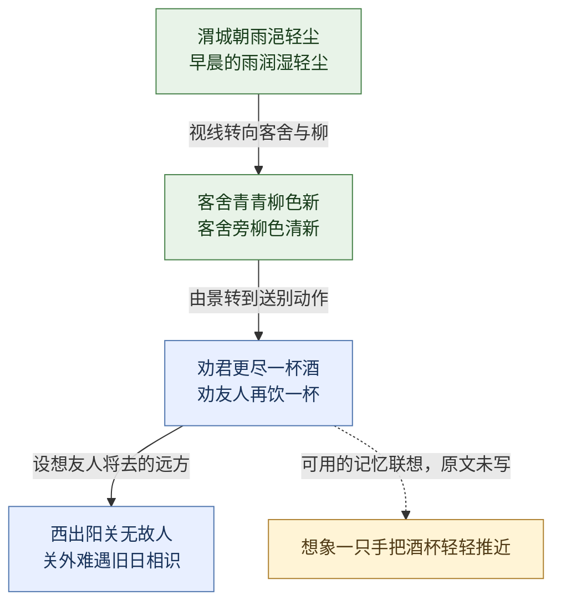
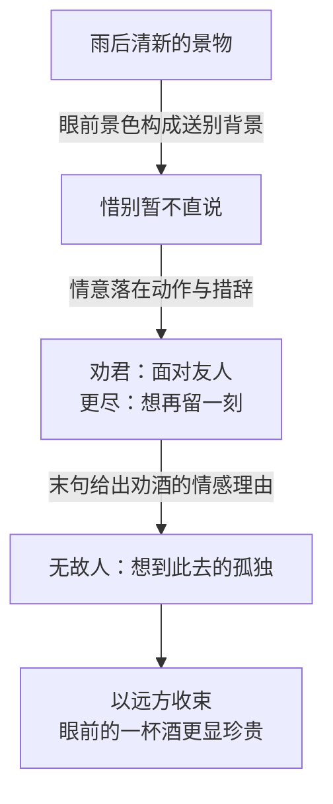

# 送元二使安西 — 王维

> 公开方法示例，采用通行文本说明笔记、图解与练习方式，未对特定《唐诗三百首》版本逐页核对。此例不代表用户已经读过或背过这首诗。背景不据此确定具体创作年份。

## 原文

渭城朝雨浥轻尘，客舍青青柳色新。
劝君更尽一杯酒，西出阳关无故人。

出处标识：王维《送元二使安西》，通行文本；又常称《渭城曲》。实际书籍档案中应补所用选本版本及原文定位。

## 一眼认识

友人在清新的雨后早晨即将远行，送别者劝他再喝一杯，想到他走出阳关后将难遇旧日相识。

| 维度 | 标注与依据 |
|---|---|
| 体裁 | 七言绝句：四句，每句七字；本例不作逐字平仄鉴定 |
| 题材 | 送别为主，兼有关塞远行；不能因出现阳关就标为战争诗 |
| 风格 | 清新而含蓄：前两句景物清润，惜别寄托在劝酒动作中 |
| 情感 | 惜别、关切、对远行者孤独的牵挂 |
| 技法 | 写景后转劝酒，以设想中的远方收束；“更”增加不舍意味 |

## 字词与必要背景

- **朝雨**：早晨的雨。“朝”在这里读 zhāo。
- **浥**：读 yì，沾湿、润湿。雨润轻尘，使眼前空气与道路带有清润感。
- **更尽**：再饮尽。“更”在这里读 gèng；“再”提示劝留之意，却不能据此推定已经喝了几杯。
- **故人**：旧日相识、老朋友，不能按现代另一种语境理解为逝者。
- **使安西**：题意是出使安西。这里保留必要方向信息，具体使命、行程与年份不作无来源补写。
- **渭城、阳关**：一处是送别诗中眼前场景，一处是所设想西行的关塞；后两句不是诗人已经跟随朋友到达阳关的记录。

柳在送别传统中常有关联，但本诗没有直接写折柳动作；不能把折柳赠别记作这首诗发生的事实。若专题研究地理或折柳风俗，应另查可靠资料。

## 画面与背诵路线

背诵可以想成四个镜头：**雨润尘 → 柳色新 → 再劝酒 → 想到关外**。最后一个镜头是设想，不是实地镜头。推酒杯只是记忆辅助，也可以换成你自己的动作想象。

## 情感与章法

“更”不是多余的字，它让一杯酒带上了再延长相处的意味。末句把视野从眼前移向关外，解释为什么这一次相聚值得珍惜。“无故人”可以理解为对陌生旅途的担忧，不宜断言友人未来绝不可能遇见任何熟人。

## 背诵卡

| 提示画面 | 准确措辞连接 |
|---|---|
| 雨润尘 | 地点“渭城”＋时间“朝雨”＋动作“浥”＋对象“轻尘” |
| 柳色新 | “客舍青青”与“柳色新”相接，不自行替换成意思相近的景物描述 |
| 再劝酒 | 记住“劝君更尽”，尤其“更”连接惜别情感 |
| 想到关外 | “西出阳关”标方向，“无故人”收束情意 |

可能易混：将“浥”换成“湿”，把“更尽”背成“饮尽”，或按自己的话重排句序。这些是提示，不是用户真实错题。

回忆题：四个镜头依次是什么？哪个字表达“再留一刻”的感受？最后一句是眼前事实还是对远行的设想？

回忆后核对

雨润尘、柳色新、再劝酒、想到关外；“更”；末句面向未来旅途的设想。全文回忆请对照上方固定版本，核对字词与句序。

## 日常表达

适合：朋友即将到陌生城市生活，送行时表达留恋和关切。引用后两句时，情感重点是珍惜眼前相聚、牵挂此去的陌生环境。

边界：现代交通、通信使“无故人”未必符合实际，可说明是借用其惜别意味；这首诗的“故人”不能用作它本来就在悼念逝者的证据。

## 学一点表达

练习：不直接说“舍不得”，写一个你送人离开时的小动作，例如放慢脚步、又叮嘱一句、在门口多站片刻。先写一句自然的话，再尝试压缩成两句，不要求当场写成绝句。

助手示范〔自由表达，非古人原句，也未作格律检查〕：

> 送到街口，又陪你等了一盏绿灯。

这里学的是“动作承载情感”，不是模仿古诗字数。用户实际作答后再保存原稿、反馈与改稿；本示例不预先填入学习进度。
