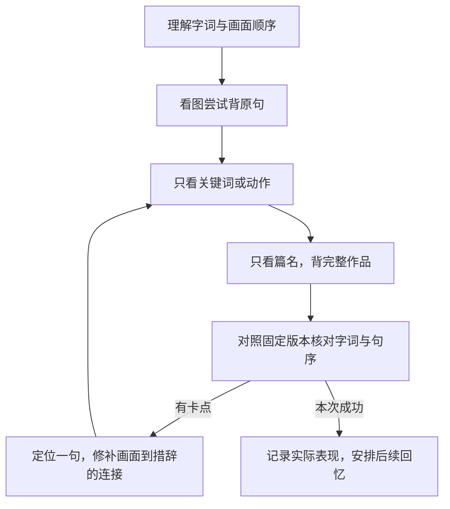

# 画面背诵与复习

## 以用户自己的画面为起点

先读取已有记忆画面与卡点；用户没有提供时，根据原诗示范一条路线即可，不把“分享画面”变成必答问题。画面不够清晰时利用视线、声音、动作、空间远近、语气与情感转折，不强制所有句子变成电影。

每个记忆单元建立三层连接：

1. **文本信息**：原诗确实写了什么。
2. **记忆联想**：用户或助手额外想象的镜头，明确标识。
3. **准确措辞**：为什么这个画面提示的是这几个字，哪些字容易被意思相近的词替换。

把近似含义的复述与正确背诵分开；不要求想象与别人相同，只核对诗句和版本。画面法是个人适用的办法，不宣称保证长期记忆或适合所有人。

## 主动回忆与提示层级

这表示可选择的学习路线，不是用户每次必须完成的程序。互动练习默认先出题并等待作答，不同一条消息立即公布答案；文件笔记可把答案放折叠区。用户要求直接给答案或一次性自学材料时遵从。

卡住时从较少提示开始：画面／情绪 → 首字或关键动词 → 韵脚 → 半句 → 完整句。记录本次依赖了哪层提示，后续逐渐减少，不让“看着全文流畅读完”充当独立回忆。

## 核对与反馈

- 对照用户选定版本，检查漏句、顺序、替换字和异文。合法异文先确认版本，不能把另一个通行版本直接判错。
- 反馈先指出具体卡点，再给一个可操作的记忆连接。例如某句以动作收束，就用动作提示该句动词；不用泛泛要求多背几遍。
- 容易串诗时比较篇名、首句、场景与收束方式；要么用确实出现的两首，要么明确只是示例，不能猜用户背过哪些。
- 用户打字复述只验证文本回忆，不代表验证了朗读发音或节奏。没有音频时不宣称听出了读音错误。
- 预判易错与用户真实错误分栏；不要在所有作品上生成虚假的“我的错题”。

## 复习建议与状态

可以建议当日隔一会儿、次日、约三日、一周、数周做回忆；这是可调整的起点，不是保证效果的固定算法。轻松独立回忆时延长间隔；多次卡住时缩短并针对卡点练，不要求从头抄整篇。

具体日期由用户时间上下文计算，缺少日期就用相对间隔。复习建议与实际复习分开写，不提前记完成。除非用户明确请求并且已有自动化工具确实创建成功，否则不承诺主动提醒或后台跟踪。

已有三十多首的情况：先保存总体自述，有篇目列表时再建立逐首状态。复习可以让用户选熟悉、易混、久未背的作品；未知篇目不自动分配练习。全书整理不等于全书立即纳入每日背诵任务。
