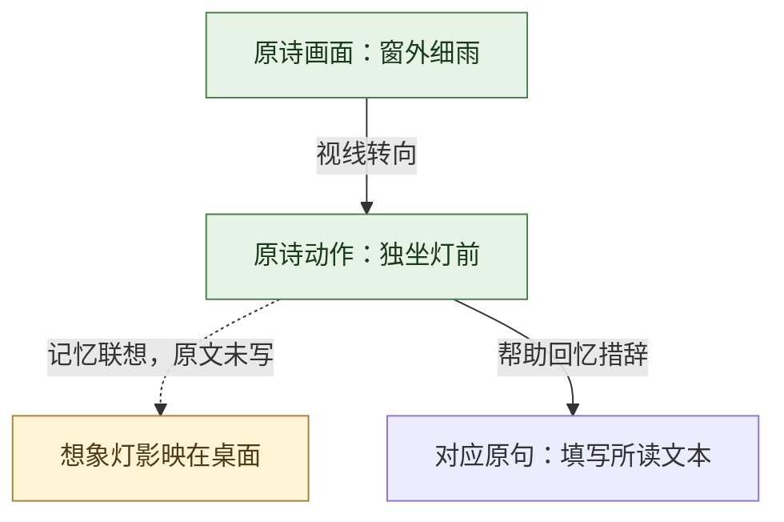

# Mermaid 画面、情感与学习图

## 两张默认图

1. **画面与背诵路线图**：按原诗呈现顺序，把关键景物、声音、动作或心理画面连接起来，用原句或辨识词提示准确背诵。每个节点优先一到两句；长篇按段分图。
2. **情感与章法图**：说明感受如何通过景物、动作、对照、想象、转折与收束呈现。不能只是换一套颜色重复第一张图，要体现表达机制。

不必硬设“起承转合”，也不必把每首都解释成情绪递增。情感可能并置、往复或贯穿不变。静景用视线和意象关系，心理诗用概念对照与语气，不虚构人物行走。

## 其他有用图

| 情况 | 建议 |
|---|---|
| 词的上下片转换 | 分片 subgraph，标清叙述时间、转折与承接 |
| 今昔、虚实、远近切换 | 并列子图，连线说明“回忆”“设想”“对照” |
| 意象反复出现 | 意象 → 语境 → 本诗情感，避免宣称某意象永远只有一种意义 |
| 相同题材不同风格 | 同一表达任务 → 不同诗句 → 不同语气与效果 |
| 典故或背景 | 已核实背景 → 具体诗句 → 理解影响；无来源不画确定因果 |
| 学填词 | 生活感受 → 选画面 → 句式分配 → 韵脚 → 表达及格律复核 |
| 复习 | 画面 → 首字 → 句子 → 全篇，按用户表现减少提示 |

## 语法与可读性

- 用 fenced `mermaid`，优先 `flowchart TB`，短且适合横向比较时用 LR。
- 节点 ID 用英文数字，如 A1、scene2；中文标签用双引号，节点内换行用 ` `。
- 节点不要含 Markdown 双链、复杂 HTML 或未转义的引号；链接放图外。图内只用已经在文字中解释的内容。
- 主要节点一般 4–10 个；长篇按段拆图。标签短，详细解释在正文。为背诵保留的完整诗句可稍长。
- 箭头明确标「视线转到」「诗句推进」「回忆」「想象」「情绪转折」等；先后关系不能冒充因果，设想不能画成真实行程。
- 事实关系用实线；解释性推断或记忆补充用虚线并写清性质。颜色帮助阅读但不承担唯一语义，保留文字标签。

以上是图法示意，不是某首古诗的原文或已核实事实，不复制其中填空到正式笔记。

## 图义与渲染核对

先检查节点对应原句、顺序及边标签，再检查围栏、节点 ID、引号、subgraph 和 class 引用。环境已有 Mermaid 渲染器时用它核对实际显示，修复超宽、遮挡与语法错误；没有时保留标准保守语法并说明只做静态检查。不要为了渲染悄悄删掉诗中的复杂时间或情感关系。
