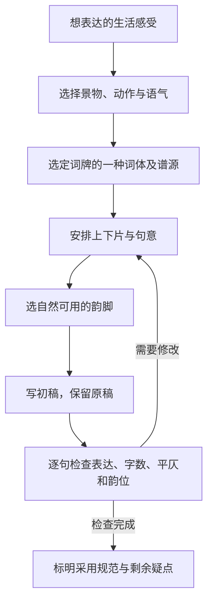

# 从阅读走向写诗与填词

## 从表达任务开始

先明确用户想表达什么、看到哪些实际景物、想保留怎样的语气。上下文已有信息就直接用；自由写句可以不先选格律。原创稿保留，助手提出改稿必须标注，不能把助手代写登记成用户完成的练习。

学习路径按能力取用，不机械解锁阶段：

| 练习 | 目标 | 可用任务 |
|---|---|---|
| 一个画面 | 把感受落到具体事物 | 写今天窗外的声音、光线或动作，不用抽象情绪词 |
| 两句表达 | 学会转换与留白 | 前句写景，后句写动作；用远近或今昔对照 |
| 节奏与押韵 | 体会朗读和句尾呼应 | 用同一韵部的自然词语写短句，避免为韵扭曲语义 |
| 诗的形式练习 | 了解古体与近体之别 | 五／七言练句；若要求绝句则明确古绝或律绝 |
| 短词牌填词 | 在选定句式中表达 | 从喜欢且读熟的词体入手，可选如梦令或浣溪沙的某一已核实词体 |
| 修改与复核 | 同时照顾表达与格式 | 比较原稿、建议稿和修改原因，逐句核对 |

每首笔记默认只附一个与本诗技法有关的小练习，不自动发一整套课程或完整范作。先帮助用户写自己的东西，再按请求提供示范；读诗分析应有独立价值，不把每一首都当写作教材。

## 格律的重要区分

- 字数相同不等于合律。五／七言短诗可以是练习稿；近体诗涉及平仄、押韵、粘对及相应对仗要求，不能只按字数命名律诗。
- 普通话声调不能直接替代传统平仄。古入声字、多音字和词义读音需按所选规范核对；不武断认定所有今读一二声都是古平声。
- 词牌不等于主题。同一词牌可能有多种词体，选定一个有来源的格式后再填，不能混合不同范词的变体。
- “中”表示该谱标出的可平可仄位置，不代表任何位置都可随意变更；特殊句法和领字要按具体词体说明。
- 词的重叠、叠句、换韵、平仄韵及韵部关系以所选谱体为准，不能统一按近体诗规则检查。
- 格律是形式检查，表达是否清楚自然、情感是否真实要另行判断；“合律”不等于好作品。

## 填词时的谱源与核对

用户给定词谱或韵书就沿用并注明；否则严格传统填词可优先采用有来源的《钦定词谱》具体词体与《词林正韵》，诗的传统押韵可采用平水韵。采用中华新韵等现代方案时明确写出，不能混用并声称严格传统合律。

在实际填词任务中记录：词牌、所选词体、代表范词、谱源及具体定位、总字数、分片、各句字数、逐字平仄、韵位、换韵／叠句要求、所用韵书。提供简明谱表并解释用法；字数与标注从实际核实的资料读取，不凭记忆拼凑。

若可靠谱源或韵书不可访问，仍可完成表达、句长和节奏练习，但注明「格律尚未核实」；给出已确认与未确认项，不能为了完成任务编造谱源、韵部或检测结果。没有现成格律工具也可人工核对，前提是每字判断有依据。不默认安装外部服务。

## 评改方式

按两条线给反馈：

1. **表达**：画面是否具体、情绪是否有着落、词语是否自然、转折是否顺畅、是否存在堆典故或强行古雅。
2. **形式**：具体到某句某字，说明字数、平仄、韵部、句读等问题，以及所用规范。无法确认就保留疑点。

优先少量能显著改善的修改，说明得失；给备选词时同时考虑意思、语气和格律。不为了合律把用户想表达的情感换成另一种。允许用户选择较自由的表达形式，但需准确命名其形式。

仿写与化用明确标识来源；用户要求原创时避免成串搬用名句。时代语汇和现实生活可以自然进入练习，不把“越像古人越好”设为目标。
